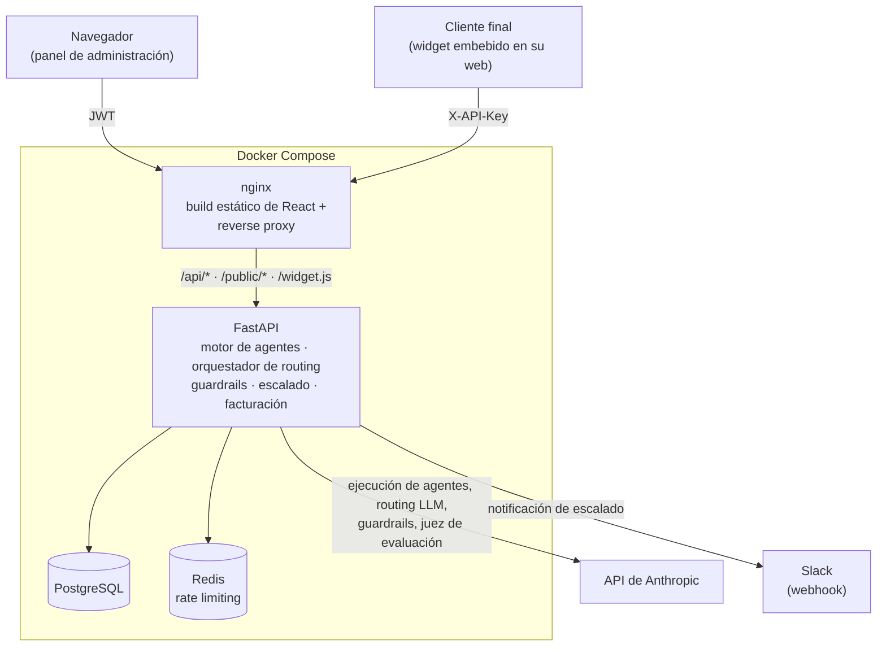

# Agent Ops

**Una plataforma SaaS multi-tenant de orquestación de agentes de IA para empresas** —
backend en FastAPI con llamadas reales a la API de Anthropic, y un panel de
administración completo en React.

Cualquier empresa (tenant) puede configurar varios agentes de IA especializados
(soporte, ventas, backoffice...), dejar que un orquestador decida automáticamente
qué agente atiende cada mensaje, aplicar guardrails de contenido y coste, escalar
a un humano cuando la IA no tiene suficiente confianza, y ver todo el proceso —
coste real, latencia, tasa de resolución — en un panel de observabilidad. Incluye
planes de suscripción y facturación simulada, como en un producto SaaS real.

Es un proyecto construido de punta a punta en 12 fases incrementales, cada una
verificada contra infraestructura real (Postgres, Redis, Docker, y la API real
de Anthropic) antes de pasar a la siguiente — no hay mocks permanentes ni "TODO"
pendientes.

## Capturas de pantalla

> Pendiente de añadir. Con el stack levantado (`docker compose up --build`,
> ver más abajo), regístrate en `http://localhost:8080/register` y captura:
>
> | Archivo | Qué mostrar |
> |---|---|
> | `docs/screenshots/dashboard.png` | `/` — tarjetas de métricas + gráfico de interacciones con algo de actividad real |
> | `docs/screenshots/agents.png` | `/agents` — el catálogo de plantillas abierto (`Desde plantilla`) |
> | `docs/screenshots/traces.png` | `/traces/{id}` — el detalle de una traza con el desglose de latencia por etapa |
> | `docs/screenshots/billing.png` | `/billing` → pestaña "Planes" — la comparación de los 4 planes |
>
> Guárdalas en `docs/screenshots/` con esos nombres y las cuatro filas de la
> tabla de arriba se convertirán en imágenes automáticamente al abrir este
> README en GitHub.

## Arquitectura



`nginx` sirve el build estático del frontend y hace de proxy inverso hacia el
backend para `/api/*`, `/public/*` y `/widget.js` — el navegador solo habla con
un origen, igual que en desarrollo local (donde ese mismo papel lo hace el
proxy del servidor de Vite). Ni el panel de administración ni el widget
embebible necesitan configuración de CORS en producción.

## Funcionalidades principales

**Núcleo multi-tenant y motor de agentes**
- Aislamiento estricto por `tenant_id` en cada tabla y cada consulta
- Agentes configurables por tenant (prompt de sistema, modelo, temperatura, tokens)
- Ejecución real contra la API de Anthropic, con coste y latencia calculados por interacción

**Orquestación inteligente**
- Reglas de routing por palabra clave o categoría, con prioridad
- Fallback a un router basado en LLM (tool use forzado) cuando ninguna regla coincide
- Probador en vivo: qué agente resultaría de un mensaje, sin gastar nada

**Seguridad y control**
- Guardrails de entrada y salida: lista de bloqueo, detección de PII, longitud máxima, chequeo personalizado por LLM
- Límites de tasa (Redis, sliding window) y de coste mensual por tenant
- Cola de escalado a humano cuando la IA no tiene confianza suficiente o un guardrail bloquea la respuesta

**Calidad y observabilidad**
- Framework de evaluación con dataset dorado (30 casos) y un LLM-as-judge
- Traza completa de cada interacción: routing, guardrails, coste y latencia por etapa
- Dashboard de métricas con series temporales y desglose por agente

**Gestión y permisos**
- Roles (`viewer` / `operator` / `admin`) aplicados en API y UI
- Catálogo de 5 plantillas de agente listas para usar, con guardrail recomendado
- Modo de prueba que ejercita el pipeline real sin persistir nada en el historial
- Checklist de onboarding guiado

**Integraciones externas**
- API pública autenticada por API key (independiente del JWT interno) para clientes finales
- Widget de chat embebible, sin build ni dependencias
- Notificaciones reales de escalado a Slack

**Modelo de negocio**
- 4 planes de suscripción con límites diferenciados, facturación por excedente configurable
- Facturación mensual simulada generada a partir del uso real registrado

**Panel de administración (React)**
- Cubre las 11 secciones anteriores con estados de carga/error consistentes y diseño responsive

## Stack tecnológico

**Backend**
Python 3.12 · FastAPI · SQLAlchemy 2.0 (async) · PostgreSQL · Alembic · Redis ·
Pydantic v2 · SDK oficial de Anthropic · pytest · ruff · black

**Frontend**
React 19 · TypeScript · Vite · Tailwind CSS 4 · React Router 7 · TanStack Query 5 ·
React Hook Form + Zod · Radix UI · Recharts · lucide-react

**Infraestructura**
Docker Compose · nginx

## Instalación y arranque local

Requisitos: Docker y Docker Compose.

```bash
git clone <url-del-repo>
cd agent-ops

cp .env.example .env
# edita .env y añade tu ANTHROPIC_API_KEY (https://console.anthropic.com/settings/keys)
# — opcional: sin ella, todo funciona excepto la ejecución real de agentes

docker compose up --build
```

Abre `http://localhost:8080`, crea una cuenta y ya tienes un tenant en el
plan Free listo para configurar tu primer agente.

Para desarrollo con hot-reload en vez del build de producción, consulta
[`backend/README.md`](backend/README.md) y [`frontend/README.md`](frontend/README.md) —
cada uno explica cómo levantar su servidor de desarrollo por separado contra
`docker compose up -d postgres redis`.

## Decisiones técnicas destacadas

Selección de las decisiones más representativas de todo el proyecto — el resto
está documentado inline en el código y en los README de cada módulo.

- **Rate limiting con sliding-window log en Redis, no ventana fija ni token
  bucket.** Una ventana fija permite hasta 2× el límite real en una ráfaga a
  caballo entre dos ventanas; un token bucket es mejor cuando quieres permitir
  ráfagas controladas con recarga continua, que no es el caso de un simple
  "N mensajes por minuto" — y su lógica de recarga es más difícil de testear
  con precisión que un conteo exacto por ventana deslizante.

- **Los límites de plan y los límites propios del tenant se combinan en
  vivo (`min()`), nunca se migran.** Cuando un tenant cambia de plan, sus
  valores de `tenant_limits` no se reescriben — el límite efectivo es
  siempre el más estricto de los dos, calculado en cada petición. Una
  bajada de plan surte efecto inmediato sin ningún paso de migración, y los
  valores propios de un admin nunca se pierden si vuelve a subir de plan. El
  cambio de plan tampoco prorratea la factura a propósito: cobra el plan
  vigente en el momento de generar la factura, evitando la complejidad de
  rastrear tramos "vigente desde X hasta Y" dentro de un mismo mes por un
  beneficio marginal para el alcance de este proyecto.

- **`InteractionTrace` es una tabla real, no una vista.** Dos de los campos
  que necesitaba (desglose de latencia por etapa, y un coste total verdadero
  que abarca routing + guardrails + ejecución) no existen en ningún otro
  sitio — una vista solo puede reformar datos que ya existen, no
  materializar tiempos que nadie registró. Con el `AgentExecutionService` ya
  instrumentado para capturarlo, escribir una fila por turno es la
  consecuencia natural sin coste añadido, y en el lado de lectura las
  agregaciones de métricas corren como un único escaneo indexado en vez de
  cruzar varias tablas uno-a-muchos (una traza puede tener varias
  violaciones de guardrail — sumarlas ingenuamente en una tabla normalizada
  duplicaría el coste contado).

- **El modo de prueba de un agente comparte el pipeline real, pero no
  persiste nada.** `POST /agents/{id}/test` pasa por los mismos guardrails y
  la misma llamada real a Anthropic que una conversación de verdad — así el
  resultado que ve quien está probando el agente es exactamente el que
  vería un cliente real, no una aproximación que puede divergir con el
  tiempo. Sí que se sigue cobrando el coste real contra el presupuesto del
  tenant (es una llamada real), pero deliberadamente no se guarda en el
  historial de conversaciones ni en las métricas — es una decisión de
  producto, no solo técnica: nadie quiere que sus pruebas contaminen sus
  estadísticas de resolución automática.

- **Las API keys se hashean con SHA-256, no con bcrypt.** Al contrario que
  una contraseña, una API key ya tiene 256 bits de entropía real, así que un
  hash rápido no supone ningún riesgo de fuerza bruta — y uno determinista es
  justo lo que hace posible un `WHERE key_hash = ?` indexado. La sal
  aleatoria de bcrypt, pensada para contraseñas de baja entropía, haría
  imposible esa búsqueda sin ya saber qué fila comparar.

- **El `claim` de un caso escalado es un `UPDATE ... WHERE status = 'pending'`
  atómico, no un `SELECT` seguido de un `UPDATE`.** Dos operadores pueden
  intentar tomar el mismo caso a la vez; solo uno debe ganar. Se verificó de
  verdad lanzando dos peticiones en paralelo (`asyncio.gather`) contra
  Postgres real en el test — es la única forma honesta de comprobar que la
  condición de carrera realmente no puede darse, en vez de asumirlo.

- **El interceptor de refresco de token del frontend comparte una única
  promesa entre peticiones concurrentes.** Si varias llamadas a la API
  reciben un 401 al mismo tiempo (token recién caducado), sin ese cuidado
  cada una dispararía su propio intento de refresco en paralelo. Una
  promesa compartida asegura que solo se pide un token nuevo, y las demás
  esperan ese mismo resultado.

- **nginx en producción reproduce exactamente el proxy de Vite en
  desarrollo.** Mismo patrón en ambos entornos: el frontend nunca conoce la
  URL real del backend, solo llama a rutas relativas (`/api/...`) contra su
  propio origen, y es el servidor que lo sirve — Vite en desarrollo, nginx
  en producción — quien reenvía la petición. El resultado es que no hace
  falta configurar CORS en ningún entorno, y el mismo build del frontend
  funciona igual en ambos sin variables de entorno que fijar.

## Estructura del repositorio

```
agent-ops/
├── backend/          # API FastAPI — ver backend/README.md
│   ├── app/           # código de la aplicación
│   ├── alembic/        # migraciones
│   ├── eval/            # framework de evaluación — ver eval/README.md
│   ├── tests/            # suite de pytest
│   └── scripts/            # generación mensual de facturas
├── frontend/         # panel de administración React — ver frontend/README.md
│   └── src/
├── infra/            # scripts de infraestructura (init de la BD de test)
├── docker-compose.yml # levanta todo el stack con un comando
└── .env.example       # variables para docker compose (ver más abajo)
```

## Tests

```bash
cd backend
docker compose up -d postgres redis   # desde la raíz del repo
source .venv/bin/activate
pip install -e ".[dev]"
pytest
```

175 tests cubren aislamiento multi-tenant, routing, guardrails, escalado,
límites y facturación, permisos por rol, y las integraciones externas — sin
necesidad de `ANTHROPIC_API_KEY` (los tests sustituyen el cliente de
Anthropic por un doble de prueba; el detalle está en
[`backend/README.md`](backend/README.md#tests)).

## Limitaciones conocidas

Decisiones deliberadas de alcance, no descuidos:

- La facturación es **simulada** — no hay cobro real ni integración con una
  pasarela de pago.
- Sin prorrateo al cambiar de plan a mitad de mes (justificado más arriba).
- Los tokens de sesión del frontend viven en `localStorage`, no en una
  cookie httpOnly — el trade-off estándar de una SPA sin
  backend-for-frontend (detalle en [`frontend/README.md`](frontend/README.md)).
- No hay tests automatizados de frontend en esta fase — la verificación se
  hizo manualmente contra el backend real, recorriendo cada sección en el
  navegador.

## Licencia

[MIT](LICENSE)
