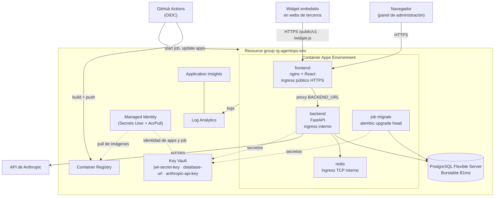

# Arquitectura en Azure

Estado: **diseñada y validada en local, nunca desplegada**. El código de
infraestructura está en [`infra/terraform`](../infra/terraform/README.md) y el
despliegue en [`.github/workflows/deploy-azure.yml`](../.github/workflows/deploy-azure.yml).

## Diagrama

## Recursos y función

| Recurso | Función |
|---|---|
| Resource group | Agrupa todo; sobre él se aplica el presupuesto. |
| Container Registry (Basic) | Almacena las imágenes del backend y del frontend. |
| Log Analytics | Destino de los logs de todos los contenedores. |
| Application Insights | Telemetría basada en el workspace (conexión inyectada; la app aún no usa el SDK). |
| Container Apps Environment | Entorno de ejecución y red compartida de las apps. |
| App `frontend` | nginx con el build de React. Único servicio con ingress público; hace proxy de `/api`, `/public` y `/widget.js` al backend. |
| App `backend` | FastAPI. Solo accesible desde dentro del entorno. |
| App `redis` | Redis 7 interno para el rate limiting. Una sola réplica, sin persistencia. |
| Container Apps Job `migrate` | Ejecuta las migraciones de Alembic bajo demanda, antes de actualizar las apps. |
| PostgreSQL Flexible Server (B1ms) | Base de datos de la aplicación. |
| Key Vault | Guarda `jwt-secret-key`, `database-url` y `anthropic-api-key`. |
| Managed Identity | Identidad de apps y job: lee secretos del Key Vault y descarga imágenes del ACR, sin credenciales almacenadas. |
| Presupuesto mensual | Avisa por email al 50 %, 80 % y al 100 % previsto. |

## Coste mensual estimado

**Estimación orientativa, no verificada con la calculadora de Azure**: precios
de pago por uso aproximados para West Europe, uso bajo (entorno de desarrollo
o pruebas). Confírmala con la
[calculadora de Azure](https://azure.microsoft.com/pricing/calculator/) antes de
desplegar.

| Recurso | Supuesto | USD/mes aprox. |
|---|---|---|
| PostgreSQL Flexible B1ms | 1 vCPU, 2 GiB, 32 GiB de disco, siempre encendido | 16–18 |
| Container Apps: backend | 0,5 vCPU / 1 GiB, 1 réplica, casi siempre inactiva | 8–15 |
| Container Apps: frontend | 0,25 vCPU / 0,5 GiB, 1 réplica | 4–7 |
| Container Apps: redis | 0,25 vCPU / 0,5 GiB, 1 réplica | 4–7 |
| Container Registry Basic | | 5 |
| Log Analytics | primeros 5 GB/mes gratis; tras eso ~2,8 USD/GB | 0–5 |
| Key Vault | operaciones de lectura de secretos | < 1 |
| Application Insights | comparte workspace | 0 |
| **Total infraestructura** | | **~40–60** |

- Las Container Apps tienen una cuota mensual gratuita por suscripción (180.000
  vCPU-s, 360.000 GiB-s y 2 millones de peticiones) que reduce algo la cifra.
- Con tráfico real el consumo "activo" cuesta ~8 veces más por vCPU-s que el
  inactivo; el backend es lo que más crece.
- **No incluye la API de Anthropic**, que depende del uso y suele ser la mayor
  partida. El límite de coste mensual por tenant de la aplicación ayuda a
  acotarla; el presupuesto de Azure no la ve.

## Decisiones técnicas

- **Container Apps en lugar de AKS o App Service.** Escala a cero réplicas si
  se quiere, no hay clúster que operar, y soporta jobs e ingress interno. Para
  una aplicación de 3 servicios, Kubernetes es coste operativo sin beneficio.
- **Un único punto de entrada público (nginx).** Se conserva el diseño actual:
  el navegador habla con un solo origen y nginx hace proxy. El backend no se
  expone a Internet. El proxy se configura con `BACKEND_URL` y envía `Host` del
  upstream (`$proxy_host`) porque Container Apps enruta el tráfico interno por
  cabecera `Host`.
- **Migraciones en un job aparte** (`RUN_MIGRATIONS_ON_START=false` en Azure).
  Con varias réplicas, migrar al arrancar provoca carreras y un fallo de
  migración tumba la revisión en ejecución. El workflow ejecuta el job, espera
  a que termine y solo entonces actualiza las apps.
- **Redis como contenedor interno** en lugar de Azure Cache for Redis (~13 USD
  el nivel más bajo, Basic C0 sin SLA). Solo guarda contadores de rate
  limiting, que se pueden perder. Debe ser una sola réplica: con varias, cada
  una tendría sus propios contadores. Si el rate limiting pasa a ser crítico,
  migrar a Azure Cache for Redis.
- **PostgreSQL con red pública + TLS + regla "Azure services".** Evita VNet,
  subred delegada y Private DNS, que complican y encarecen un entorno pequeño.
  Es el punto a endurecer primero en producción.
- **Secretos en Key Vault con RBAC**, leídos por las apps con una identidad
  gestionada (sin contraseñas en variables de entorno de Terraform ni en el
  workflow). `JWT_SECRET_KEY` y la contraseña de Postgres las genera Terraform.
  La clave de Anthropic se guarda fuera de Terraform (`az keyvault secret set`)
  para que no entre en el estado.
- **OIDC en GitHub Actions**: sin secretos de Azure guardados en GitHub, solo
  IDs en variables.
- **Terraform ignora la imagen de las apps**: el workflow despliega por SHA con
  `az containerapp update`; Terraform no debe revertirlo.
- **`deploy_apps`**: resuelve el primer despliegue, cuando el registro está
  vacío y las apps no pueden crearse.

## CORS y el widget embebido

**Configuración actual.** Los orígenes salen de `BACKEND_CORS_ORIGINS` (JSON).
Los métodos se limitan a `GET, POST, PATCH, DELETE, OPTIONS` y las cabeceras a
`Authorization, Content-Type, X-API-Key`, que es lo que usan el panel y el
widget. En Azure, Terraform pone como único origen la URL pública del frontend.

**Efecto en el widget.** Con el panel no hay cambio: pasa por nginx, mismo
origen. El widget (`/widget.js`) llama a `/public/v1/messages` con `X-API-Key`
desde la web del cliente, es decir, **entre orígenes distintos**. Esa
cabecera personalizada obliga al navegador a hacer un preflight `OPTIONS`, y el
backend solo lo acepta para los orígenes de la lista. Por tanto, **hoy el widget
solo funciona en webs cuyo origen esté en `BACKEND_CORS_ORIGINS`**; con otro
origen el navegador bloquea la llamada. Esto no es nuevo (la lista de orígenes
ya era fija antes), pero no se ha resuelto aún.

**Propuesta: permitir solo los dominios registrados por cada tenant.**

1. Añadir `allowed_origins` (lista) a las API keys de tipo widget
   (migración de Alembic) y un campo en la pantalla de API keys del panel.
2. El preflight no lleva la clave (las cabeceras personalizadas no se envían en
   un `OPTIONS`), así que para `/public/*` el middleware responde al preflight
   permitiendo el origen solicitado, **sin credenciales** (la API usa
   `X-API-Key`, no cookies) y solo con `GET/POST` y `X-API-Key, Content-Type`.
3. En la petición real, tras resolver la API key, comparar la cabecera `Origin`
   con `allowed_origins` de esa key. Si no coincide: 403. Si coincide: añadir
   `Access-Control-Allow-Origin: <ese origen>` a la respuesta.
4. Mantener `BACKEND_CORS_ORIGINS` solo para el panel y las rutas `/api/*`.

Límite que conviene tener claro: `Origin` lo impone el navegador; no protege
frente a quien llama desde un servidor. La protección real sigue siendo la API
key (de tipo widget, ya pensada para ser pública), el rate limiting por clave y
los límites de coste del tenant.

## Pendiente antes de desplegar

- Cuenta de Azure, `az login` y valores de `terraform.tfvars`.
- `terraform plan`/`apply` por primera vez (ver el README de Terraform) y
  comprobar `ssl=require` en la cadena de conexión con el job de migraciones.
- Registrar la app de Entra ID con credencial federada para GitHub y rellenar
  las variables del workflow marcadas `TODO(azure)`.
- Implementar los orígenes por tenant para el widget.
- Decidir dominio propio y certificado (la URL por defecto es
  `*.azurecontainerapps.io`); añadirlo a los orígenes CORS.
- Estado remoto de Terraform en un Storage Account.
